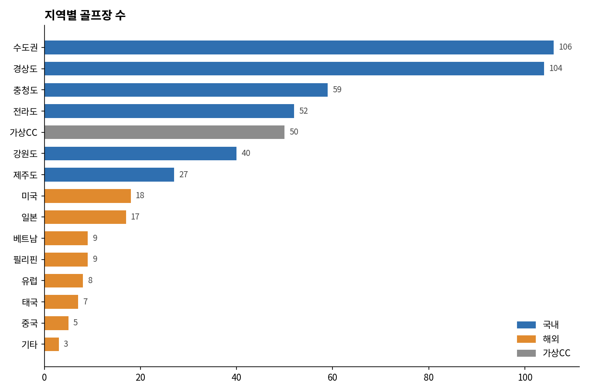
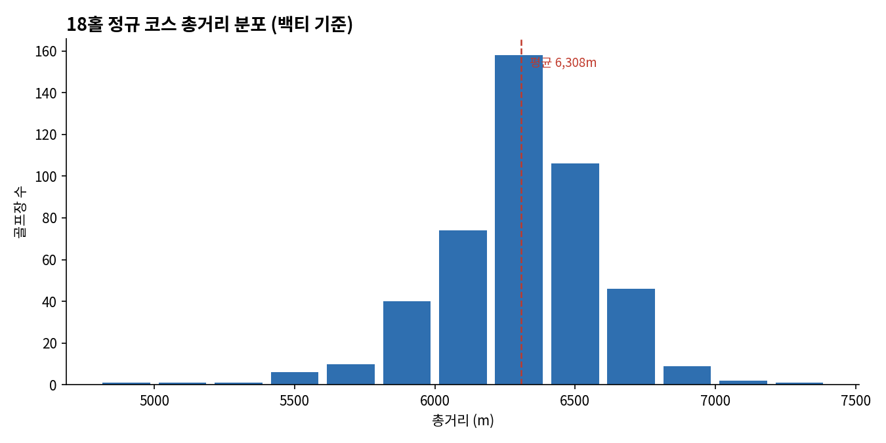
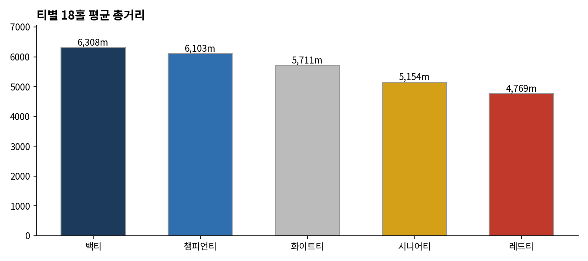
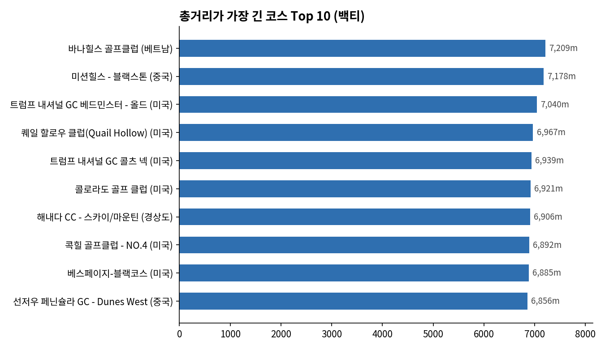
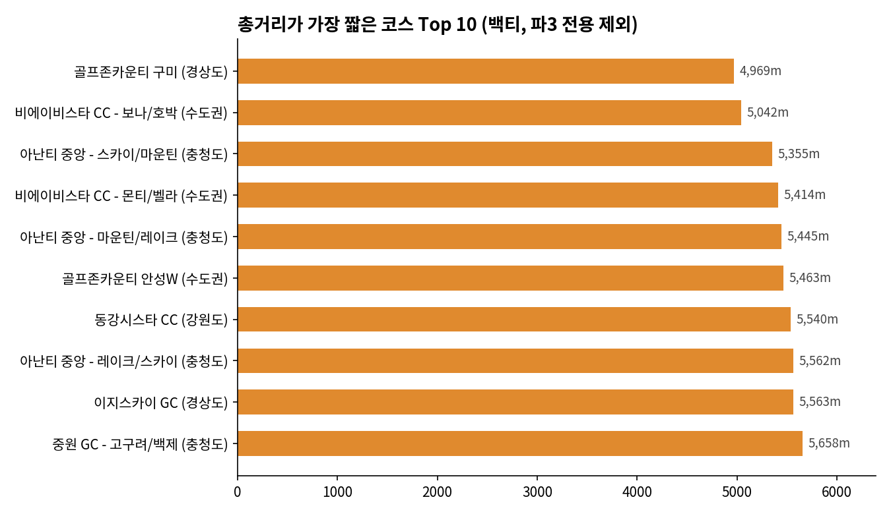
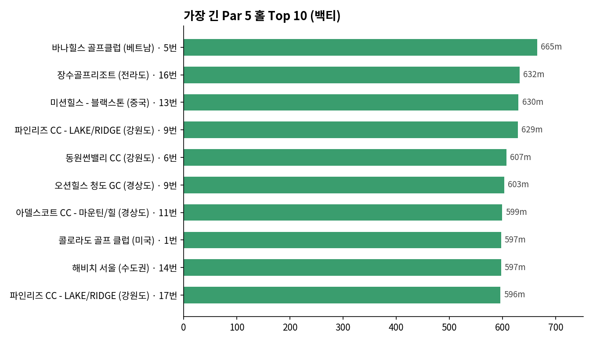
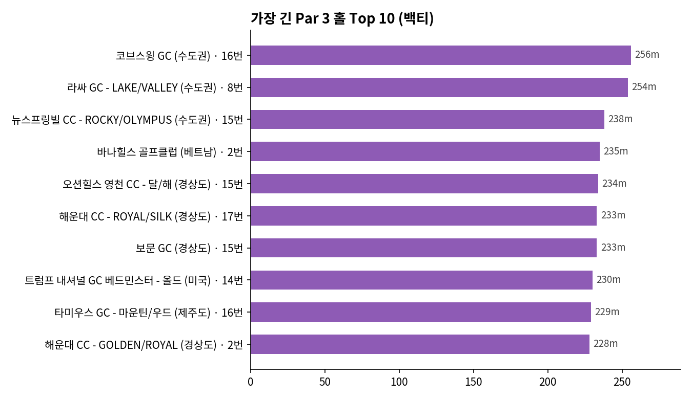
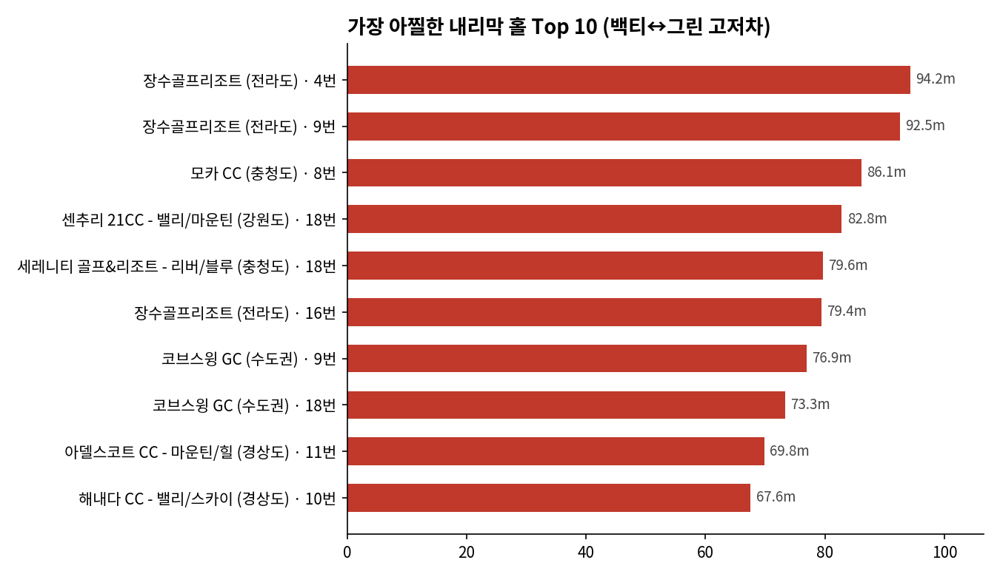
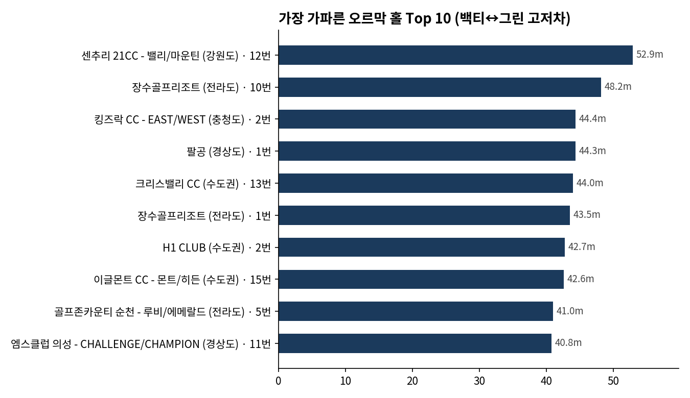

# ⛳ 골프존 골프코스 데이터 분석

골프존 사이트(`golfzon.com/course`)에 등록된 **전체 골프장 514곳**의 코스·홀 정보를 크롤링하고 분석한 결과입니다.

## 📌 탑라인 요약

- **골프장 514곳**: 국내 388곳(75%), 해외 76곳, 골프존 자체 제작 가상CC 50곳
- **지역 편중**: 수도권(106)과 경상도(104)가 국내 골프장의 절반 이상을 차지
- **평균 총거리**: 실제 18홀 정규 코스 455곳의 평균은 **백티 기준 6,308m**, 화이트티 5,711m, 레드티 4,769m
- **가장 긴 코스**: 바나힐스 골프클럽(베트남) 7,209m — Top 10 대부분이 미국·중국·베트남의 챔피언십 코스이고, 국내는 해내다 CC가 유일
- **가장 짧은 코스**: 골프존카운티 구미(경상도) 4,969m (파3 전용 코스 제외)
- **가장 긴 홀**: Par 5는 바나힐스 5번 홀 665m, Par 3는 코브스윙 GC 16번 홀 256m
- **최대 고저차**: 장수골프리조트(전라도) 4번 홀은 티에서 그린까지 **94m 내리막** (약 30층 높이)
- **18홀 구성의 정석**: 정규 코스의 89%(404곳)가 Par 3 4개 · Par 4 10개 · Par 5 4개 구성

---

## 1. 기본 현황

### 지역별 골프장 수

### 18홀 정규 코스 총거리 분포

대부분의 코스가 6,000~6,600m 구간에 몰려 있어요.

### 티별 평균 총거리

백티와 레드티의 차이는 평균 약 1,539m예요.

---

## 2. 코스 총거리 순위

### 총거리가 가장 긴 코스 Top 10

| 순위 | 골프장 | 지역 | 총거리 |
|---|---|---|---|
| 1 | 바나힐스 골프클럽 | 베트남 | 7,209m |
| 2 | 미션힐스 - 블랙스톤 | 중국 | 7,178m |
| 3 | 트럼프 내셔널 GC 베드민스터 - 올드 | 미국 | 7,040m |
| 4 | 퀘일 할로우 클럽(Quail Hollow) | 미국 | 6,967m |
| 5 | 트럼프 내셔널 GC 콜츠 넥 | 미국 | 6,939m |
| 6 | 콜로라도 골프 클럽 | 미국 | 6,921m |
| 7 | 해내다 CC - 스카이/마운틴 | 경상도 | 6,906m |
| 8 | 콕힐 골프클럽 - NO.4 | 미국 | 6,892m |
| 9 | 베스페이지-블랙코스 | 미국 | 6,885m |
| 10 | 선저우 페닌슐라 GC - Dunes West | 중국 | 6,856m |

### 총거리가 가장 짧은 코스 Top 10

| 순위 | 골프장 | 지역 | 총거리 |
|---|---|---|---|
| 1 | 골프존카운티 구미 | 경상도 | 4,969m |
| 2 | 비에이비스타 CC - 보나/호박 | 수도권 | 5,042m |
| 3 | 아난티 중앙 - 스카이/마운틴 | 충청도 | 5,355m |
| 4 | 비에이비스타 CC - 몬티/벨라 | 수도권 | 5,414m |
| 5 | 아난티 중앙 - 마운틴/레이크 | 충청도 | 5,445m |
| 6 | 골프존카운티 안성W | 수도권 | 5,463m |
| 7 | 동강시스타 CC | 강원도 | 5,540m |
| 8 | 아난티 중앙 - 레이크/스카이 | 충청도 | 5,562m |
| 9 | 이지스카이 GC | 경상도 | 5,563m |
| 10 | 중원 GC - 고구려/백제 | 충청도 | 5,658m |

---

## 3. 홀 거리 순위

### 가장 긴 Par 5 홀 Top 10

| 순위 | 골프장 | 지역 | 홀 | 거리 |
|---|---|---|---|---|
| 1 | 바나힐스 골프클럽 | 베트남 | 5번 | 665m |
| 2 | 장수골프리조트 | 전라도 | 16번 | 632m |
| 3 | 미션힐스 - 블랙스톤 | 중국 | 13번 | 630m |
| 4 | 파인리즈 CC - LAKE/RIDGE | 강원도 | 9번 | 629m |
| 5 | 동원썬밸리 CC | 강원도 | 6번 | 607m |
| 6 | 오션힐스 청도 GC | 경상도 | 9번 | 603m |
| 7 | 아델스코트 CC - 마운틴/힐 | 경상도 | 11번 | 599m |
| 8 | 콜로라도 골프 클럽 | 미국 | 1번 | 597m |
| 9 | 해비치 서울 | 수도권 | 14번 | 597m |
| 10 | 파인리즈 CC - LAKE/RIDGE | 강원도 | 17번 | 596m |

### 가장 긴 Par 3 홀 Top 10

| 순위 | 골프장 | 지역 | 홀 | 거리 |
|---|---|---|---|---|
| 1 | 코브스윙 GC | 수도권 | 16번 | 256m |
| 2 | 라싸 GC - LAKE/VALLEY | 수도권 | 8번 | 254m |
| 3 | 뉴스프링빌 CC - ROCKY/OLYMPUS | 수도권 | 15번 | 238m |
| 4 | 바나힐스 골프클럽 | 베트남 | 2번 | 235m |
| 5 | 오션힐스 영천 CC - 달/해 | 경상도 | 15번 | 234m |
| 6 | 해운대 CC - ROYAL/SILK | 경상도 | 17번 | 233m |
| 7 | 보문 GC | 경상도 | 15번 | 233m |
| 8 | 트럼프 내셔널 GC 베드민스터 - 올드 | 미국 | 14번 | 230m |
| 9 | 타미우스 GC - 마운틴/우드 | 제주도 | 16번 | 229m |
| 10 | 해운대 CC - GOLDEN/ROYAL | 경상도 | 2번 | 228m |

---

## 4. 고저차 순위

### 가장 아찔한 내리막 홀 Top 10

| 순위 | 골프장 | 지역 | 홀 | 파 | 고저차 |
|---|---|---|---|---|---|
| 1 | 장수골프리조트 | 전라도 | 4번 | Par 5 | -94.2m |
| 2 | 장수골프리조트 | 전라도 | 9번 | Par 5 | -92.5m |
| 3 | 모카 CC | 충청도 | 8번 | Par 4 | -86.1m |
| 4 | 센추리 21CC - 밸리/마운틴 | 강원도 | 18번 | Par 4 | -82.8m |
| 5 | 세레니티 골프&리조트 - 리버/블루 | 충청도 | 18번 | Par 5 | -79.6m |
| 6 | 장수골프리조트 | 전라도 | 16번 | Par 5 | -79.4m |
| 7 | 코브스윙 GC | 수도권 | 9번 | Par 5 | -76.9m |
| 8 | 코브스윙 GC | 수도권 | 18번 | Par 5 | -73.3m |
| 9 | 아델스코트 CC - 마운틴/힐 | 경상도 | 11번 | Par 5 | -69.8m |
| 10 | 해내다 CC - 밸리/스카이 | 경상도 | 10번 | Par 4 | -67.6m |

### 가장 가파른 오르막 홀 Top 10

| 순위 | 골프장 | 지역 | 홀 | 파 | 고저차 |
|---|---|---|---|---|---|
| 1 | 센추리 21CC - 밸리/마운틴 | 강원도 | 12번 | Par 5 | +52.9m |
| 2 | 장수골프리조트 | 전라도 | 10번 | Par 5 | +48.2m |
| 3 | 킹즈락 CC - EAST/WEST | 충청도 | 2번 | Par 5 | +44.4m |
| 4 | 팔공 | 경상도 | 1번 | Par 4 | +44.3m |
| 5 | 크리스밸리 CC | 수도권 | 13번 | Par 5 | +44.0m |
| 6 | 장수골프리조트 | 전라도 | 1번 | Par 5 | +43.5m |
| 7 | H1 CLUB | 수도권 | 2번 | Par 5 | +42.7m |
| 8 | 이글몬트 CC - 몬트/히든 | 수도권 | 15번 | Par 5 | +42.6m |
| 9 | 골프존카운티 순천 - 루비/에메랄드 | 전라도 | 5번 | Par 5 | +41.0m |
| 10 | 엠스클럽 의성 - CHALLENGE/CHAMPION | 경상도 | 11번 | Par 5 | +40.8m |

---

