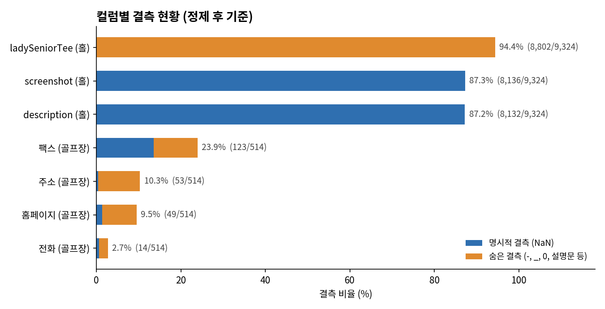

# 골프존 골프코스 데이터 EDA 보고서

2026-10-29

## 🛠 데이터 수집 방법

1. Selenium 성능 로그로 골프존 페이지의 네트워크 요청을 캡처해 내부 API를 찾음 (Vue.js SPA)
2. 목록 API `course/search/list?page=N`을 빈 응답이 나올 때까지 호출 → 52페이지, 514곳 수집
3. 골프장마다 상세 API `details`(기본정보)와 `details/hole-info`(홀별 파·티별 거리·고저차) 호출
4. `requests` 기반 수집, 요청 간 0.5초 대기, 골프장별 원본 JSON 캐시 저장

## 📁 파일 구성

| 파일 | 내용 |
|---|---|
| `golfzon_list_raw.csv` | 목록 API 원본 (골프장 514곳, 전체 컬럼) |
| `golfzon_list.csv` | 목록 정리본 (코스ID, 골프장명, 지역, 홀수, 총파, 총거리) |
| `golfzon_detail.csv` | 골프장 단위 상세 (Par 구성, PAR3 거리, 티별 합계, 기본정보) |
| `golfzon_holes.csv` | 홀 단위 상세 (홀별 파, 티별 거리, 고저차, 공략 설명) |
| `images/` | README 차트 이미지 |

## 🔎 분석 기준

- **거리**: 별도 표기가 없으면 백티(`backTee`) 기준이며 단위는 미터(m). 목록 API의 총거리(`totalWidth`)가 백티 합계와 514곳 중 513곳에서 일치함을 확인
- **티 이름 매핑**: API 필드 `frontTee`가 골프존 화면의 화이트티와 일치함을 확인(군산 CC 토너먼트 Out 1번 홀 326m). `ladyTee`는 레드티, `seniorTee`는 시니어티로 표기
- **비교 대상**: 거리·홀·고저차 순위는 가상CC를 제외한 실제 코스만 사용. 코스 총거리 순위는 18홀 정규 코스(총파 70 이상)만 비교하고 27·36홀 코스와 파3 전용 코스는 제외
- **중복 제거**: 조합 코스(예: `해운대 CC - SILK/GOLDEN`, `GOLDEN/ROYAL`)에서 반복되는 같은 홀은 티별 거리가 모두 같으면 한 번만 집계
- **고저차**: `heightBackTee` 값이 음수면 내리막(그린이 티보다 낮음)으로 해석
- **결측**: 상떼힐 익산 CC는 홀 정보가 없어 홀 단위 분석에서 제외

## 핵심 요약

골프장 514곳·홀 9,324개의 수치(파·티별 거리·고저차)는 결측 없이 파일 간 100% 일치한다. 정제가 필요한 것은 연락처·주소·URL 같은 텍스트와 표기 방식이다.

## 데이터

| 파일 | 행 × 열 | 단위 |
| --- | --- | --- |
| `golfzon_list.csv` | 514 × 6 | 골프장 |
| `golfzon_detail.csv` | 514 × 56 | 골프장 |
| `golfzon_holes.csv` | 9,324 × 28 | 홀 |

세 파일은 `코스ID`로 연결되고, 중복 행은 없다.

## 주요 이슈와 처리

| 구분 | 이슈 | 규모 | 처리 |
| --- | --- | --- | --- |
| 결측 | 상세 수집 실패 (상떼힐 익산 CC) | 1곳 | 재수집 또는 제외 |
| 결측 | 값이 전혀 없는 컬럼 | 4개 | 삭제 |
| 결측 | 팩스 · 홀 공략 설명 미등록 | 15.6% · 87.2% | 유지 |
| 숨은 결측 | 전화·팩스의 `-`, `_`, 빈칸 | 57건 | NaN |
| 숨은 결측 | `ladySeniorTee` 0m | 8,802건 (94.4%) | NaN, 분석 제외 |
| 숨은 결측 | 가상CC 주소란의 설명문 | 51건 | NaN |
| 표기 | 시도명 변형 (경기/경기도, 강원도/강원특별자치도 등) | 17종 | 정식 명칭 16개로 통일 |
| 표기 | 전화번호 형식 혼재 | 10종 이상 | 숫자·`+`만 남긴 컬럼 추가 |
| 표기 | URL 끝 공백 · 프로토콜 누락 · 골프존 대체값 | 87 · 13 · 23건 | 보정, 대체값은 NaN |
| 표기 | 골프장명 앞뒤·이중 공백 | 6건 | 정리 후 `골프장`·`코스조합` 분리 |
| 표기 | 지원 플래그가 `Y`와 빈 값으로만 존재 | 4개 컬럼 | 빈 값 = `N`, 불리언 변환 |
| 이상치 | 887m Par 5, −212m 고저차 | 가상CC만 | 유지, `구분`으로 분리 |
| 정합성 | 티 순서 역전 (화이트티 > 백티 등) | 5홀 | 유지, 플래그 |

### 컬럼별 결측 현황

### 이상치 분석

! [이상치](images/02_outliers.png)

## 정제 결과

`clean_golfzon.py`를 실행하면 `golfzon_courses_clean.csv`(514 × 53)와 `golfzon_holes_clean.csv`(9,324 × 30)가 생성된다. 국내 388곳 중 385곳에 표준 시도가 붙는다. 주소·전화·팩스·URL 결측이 늘어나는 것(2→53, 3→14, 70→123, 7→49)은 숨은 결측이 드러난 결과다. 다시 읽을 때 전화·팩스 정규화 컬럼은 `dtype=str`로 지정한다.

## 다음 단계

- 상떼힐 익산 CC 상세 정보 재수집
- 등급별 평균 타수 API(`grade/average`) 추가 수집
